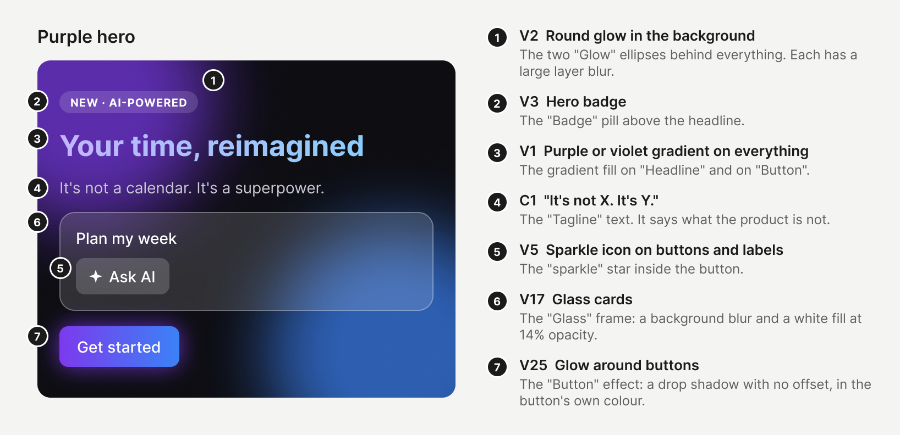
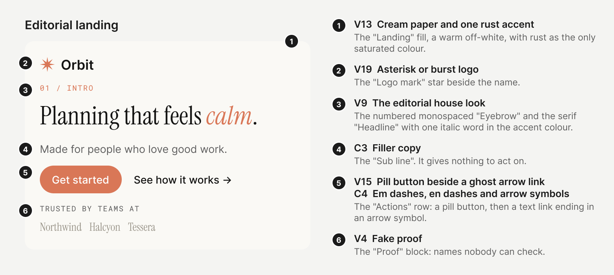
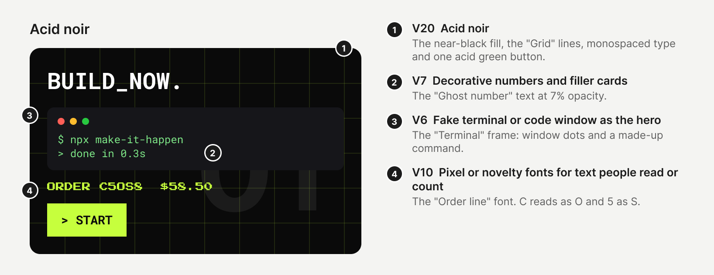
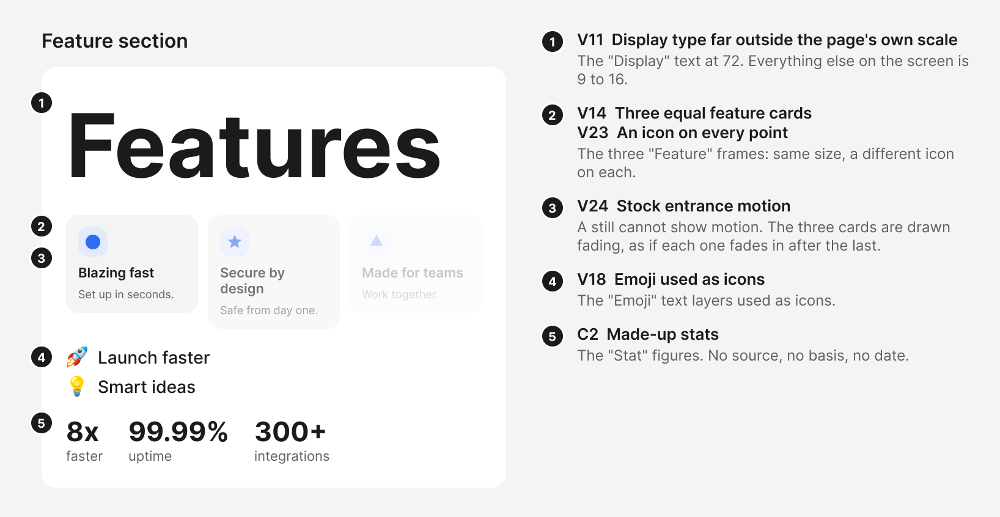
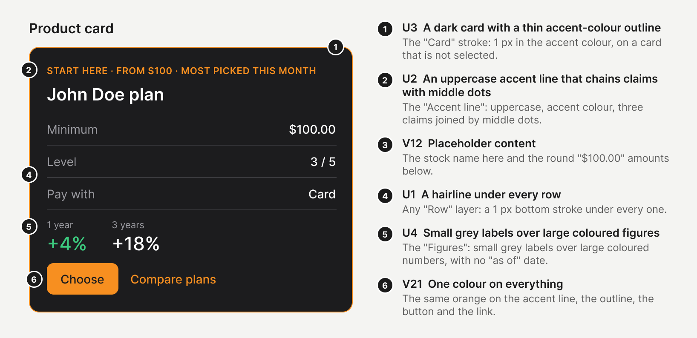
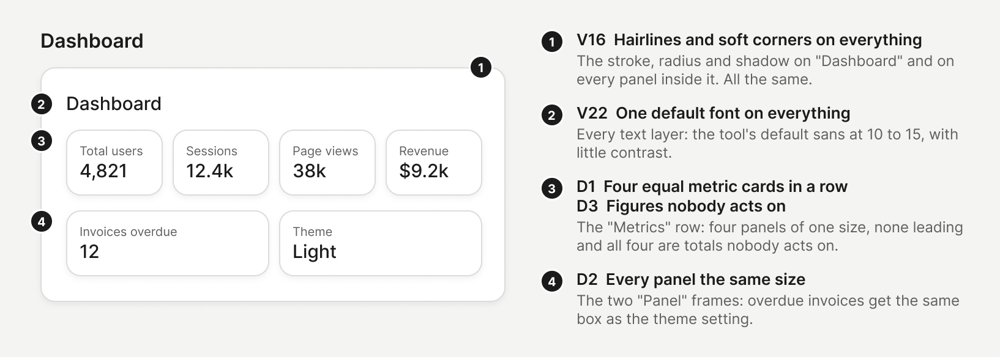
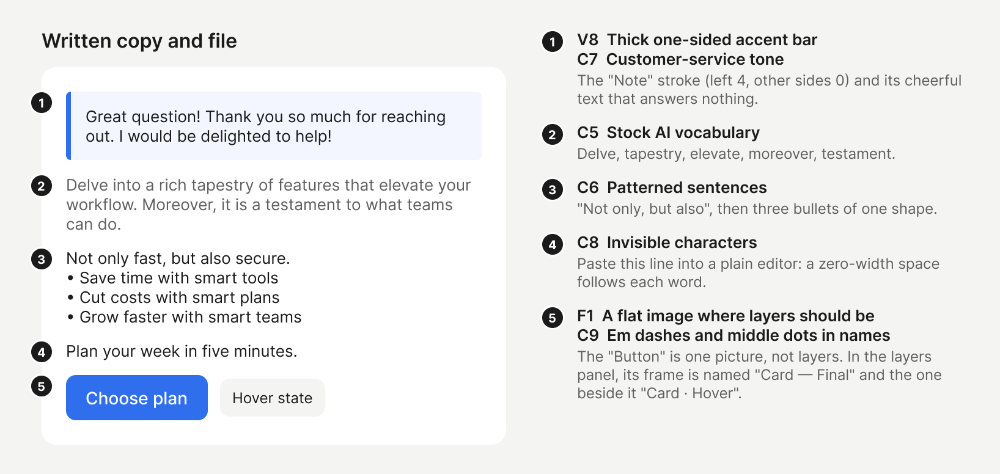

# Zero slop energy

A Claude skill and a guide for people, for catching the habits that make design work look AI-generated: defaults nobody chose, decoration with no job, claims with no source.

It is written for designers working in Figma. The same list works on web pages, UI and copy.

Kept by Shin. Last updated 28 November 2026.



## What it checks

<!-- tells -->
42 tells in five groups: 25 visual, 4 product UI, 3 dashboard, 1 Figma file, 9 copy. Names only here. How to spot each one and what to use in its place are in the skill file, [SKILL.md](skills/zero-slop-energy/SKILL.md).

**Visual**

- V1 Purple or violet gradient on everything
- V2 Round glow in the background
- V3 Hero badge
- V4 Fake proof
- V5 Sparkle icon on buttons and labels
- V6 Fake terminal or code window as the hero
- V7 Decorative numbers and filler cards
- V8 Thick one-sided accent bar
- V9 The editorial house look
- V10 Pixel or novelty fonts for text people read or count
- V11 Display type far outside the page's own scale
- V12 Placeholder content
- V13 Cream paper and one rust accent
- V14 Three equal feature cards
- V15 Pill button beside a ghost arrow link
- V16 Hairlines and soft corners on everything
- V17 Glass cards
- V18 Emoji used as icons
- V19 Asterisk or burst logo
- V20 Acid noir
- V21 One colour on everything
- V22 One default font on everything
- V23 An icon on every point
- V24 Stock entrance motion
- V25 Glow around buttons

**Product UI**

- U1 A hairline under every row
- U2 An uppercase accent line that chains claims with middle dots
- U3 A dark card with a thin accent-colour outline
- U4 Small grey labels over large coloured figures

**Dashboard**

- D1 Four equal metric cards in a row
- D2 Every panel the same size
- D3 Figures nobody acts on

**Figma file**

- F1 A flat image where layers should be

**Copy**

- C1 "It's not X. It's Y."
- C2 Made-up stats
- C3 Filler copy
- C4 Em dashes, en dashes and arrow symbols
- C5 Stock AI vocabulary
- C6 Patterned sentences
- C7 Customer-service tone
- C8 Invisible characters
- C9 Em dashes and middle dots in names
<!-- /tells -->

What matters is how many show up together, not any single one.

## Examples

Seven made-up screens that between them show every tell: the one at the top of this page and the six here. The numbers on each screen match the list beside it.













## Use it by hand

Read the list and the examples on this page, then go through a frame before you share it. The detail for each tell is in [SKILL.md](skills/zero-slop-energy/SKILL.md), which is plain text and readable as it is.

## Use it with Claude

### In the Claude app (desktop or web)

1. Download [zero-slop-energy.zip](https://github.com/dofu/zero-slop-energy/raw/main/zero-slop-energy.zip). It is a small file, about 8 KB.
2. In Claude, open Settings, then Customize, then Your skills and choose Upload a skill.
3. Drag the ZIP file in, or pick it from your Downloads folder and press Upload. If your download opened as a folder and there is no ZIP, upload the file called `SKILL.md` inside that folder. It works the same.
4. Check the switch beside "zero-slop-energy" is on.
5. Start a new chat, add a screenshot of your design and type: "Check this for AI slop."

Claude lists what it found, one line each, then asks which of them you did on purpose and leaves those out. It changes nothing until you ask it to fix something.

You only install it once.

**If you pressed GitHub's green Code button:** that downloads everything on this page as one large ZIP and Claude will not accept it. Open it and inside you will find the small `zero-slop-energy.zip`. That is the one to upload.

### Things you can ask

- "Check this for AI slop" with a screenshot.
- "Check this frame for AI slop" with a link to a Figma frame. Figma has to be connected to Claude for this. With a link, Claude can point at the exact layer.
- "Is this landing page vibecoded?" with the code or a screenshot.
- "Check this copy for AI tells" with the text.
- "Fix U1 and V21 on this frame" after a check. Claude asks for your colours, real content and the screen's main action if it does not have them.
- "Read zero slop energy before you design this screen", to use the list from the start.

### In Claude Code (only if you use Claude in a terminal)

```
mkdir -p ~/.claude/skills
git clone https://github.com/dofu/zero-slop-energy
cp -R zero-slop-energy/skills/zero-slop-energy ~/.claude/skills/
```

This adds one folder with one file, `SKILL.md`. You can delete the downloaded `zero-slop-energy` folder afterwards. For one project only, copy the folder into that project's `.claude/skills/` instead.

To update, delete the downloaded `zero-slop-energy` folder if you kept it, then run the last two commands again. To remove the skill, delete the folder `~/.claude/skills/zero-slop-energy`.

## What it does not do

- It does not judge whether a design is good. A screen can pass every check and still be the wrong screen.
- It does not overrule a brand guide or a deliberate choice. If purple is your brand colour, purple is fine; tell Claude and it will leave it alone.
- It is a list of current habits and habits change. Expect it to need updating.

## Contributing

Open an issue with a tell you keep seeing. Include a screenshot and what you would use in its place.

## Licence

MIT. See [LICENSE](LICENSE).
